# Unified Inbox: user manual

Unified Inbox shows every direct message from iMessage, Slack, and WhatsApp in one list, on every machine you use and in your phone's browser. You read and triage here. When you want to answer, one button opens the conversation in the real app, and the reply happens there.

Everything runs through your always-on Mac. That Mac holds the three connections and is the only thing that talks to the services. If it is unreachable, the inbox pauses until it is back. This manual walks through each screen.

## Opening the inbox

On a Mac or Windows PC, open the **Inbox** app. On a phone, open your inbox address (something like `https://inbox.example.net`) in the browser. The first time a device opens the inbox it introduces itself and waits to be approved. The very first device is approved automatically. Every later device shows up on the Connections screen of an already-approved device, where you approve it with one click (see "Sync and encryption" below). Until then the screen says "Connecting to hub…" and that the device is waiting for approval.

## The inbox

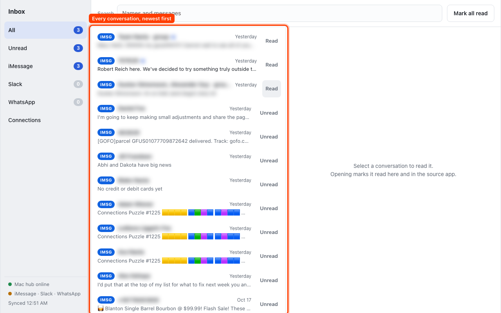

The list on the left shows every conversation, newest first. Each row has a colored tag naming its service (**Slack**, **iMsg**, **WA**), the conversation's name, the time of the last message, and a one-line preview. Group chats are labeled "· group" and their preview names who spoke last.

An unread conversation stands out three ways: its name is bold with a blue dot, its preview is darker, and it is counted in the sidebar. Any one of those is enough to see at a glance.

### Filtering and counting

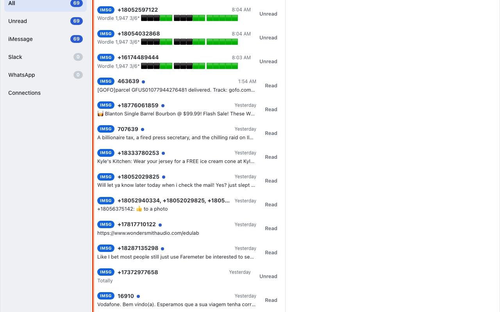

The sidebar narrows the list: **All**, **Unread**, **iMessage**, **Slack**, or **WhatsApp**. The number on each is how many conversations are unread there. The three service counts add up to the All count, so zero on All means nothing anywhere is waiting.

### Reading, and reading everywhere

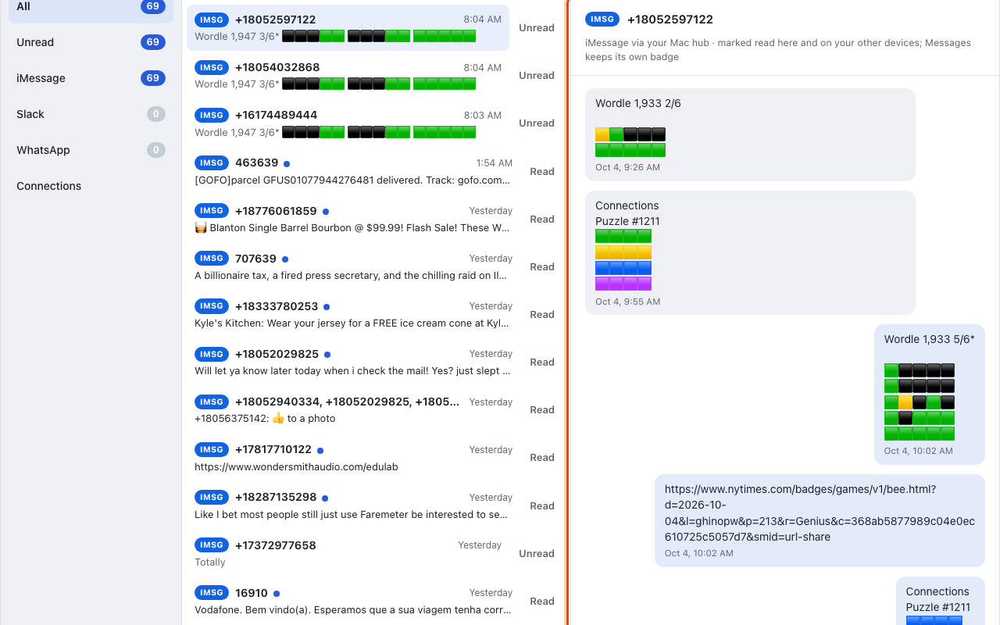

Click a row to open it on the right. Opening a conversation is what marks it read, here, on your other machines, and back in the source app, so its badge there clears too. Nothing is marked read by accident: hovering or scrolling changes nothing.

For iMessage, the Messages app on your Mac keeps its own badge. The inbox marks the conversation read here and on your other machines, but the Messages badge stays as it was; Apple offers no safe way to clear it from outside Messages.

If you opened something and want it back in the pile, press **Mark unread** in the reading pane or the **Unread** toggle on the row. **Mark all read** at the top clears everything at once.

### Replying

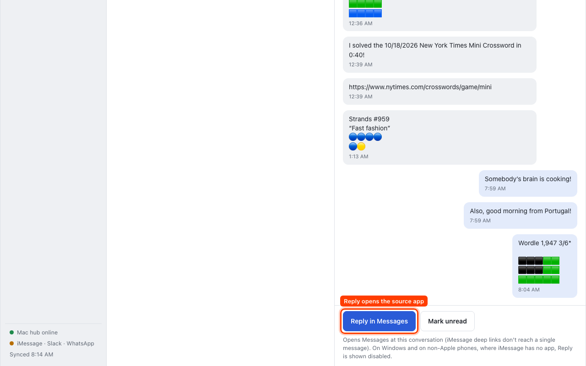

Each open conversation has one Reply button that tells you where it leads: **Reply in Slack**, **Reply in Messages**, or **Reply in WhatsApp**. It opens the source app at that conversation, at the exact message where the app allows it (Slack), and at the conversation where it does not (Messages and WhatsApp one-to-one chats; WhatsApp groups open the app). If the app is not installed on the machine you are using, Reply opens the service's web version instead. On Windows and on non-Apple phones there is no Messages app, so Reply on an iMessage conversation is shown grayed out.

### Searching

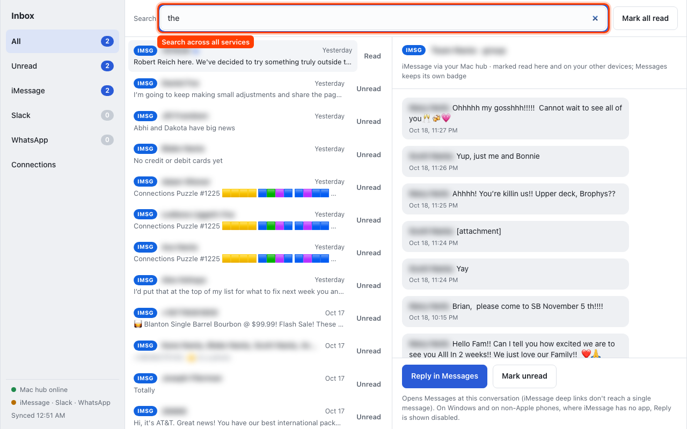

The search box finds names and message text across every synced conversation at once. Press **/** to jump to it.

### Keyboard

Up and Down move through the list, Enter opens, **R** replies, **U** toggles unread, and **/** focuses search.

### On a phone

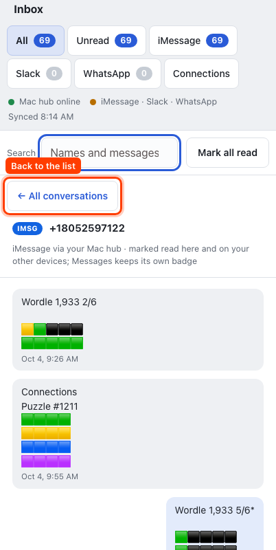

In a phone browser or a narrow window the sidebar becomes a row of chips, and opening a conversation replaces the list with the thread. **← All conversations** at the top returns to the list.

## All caught up

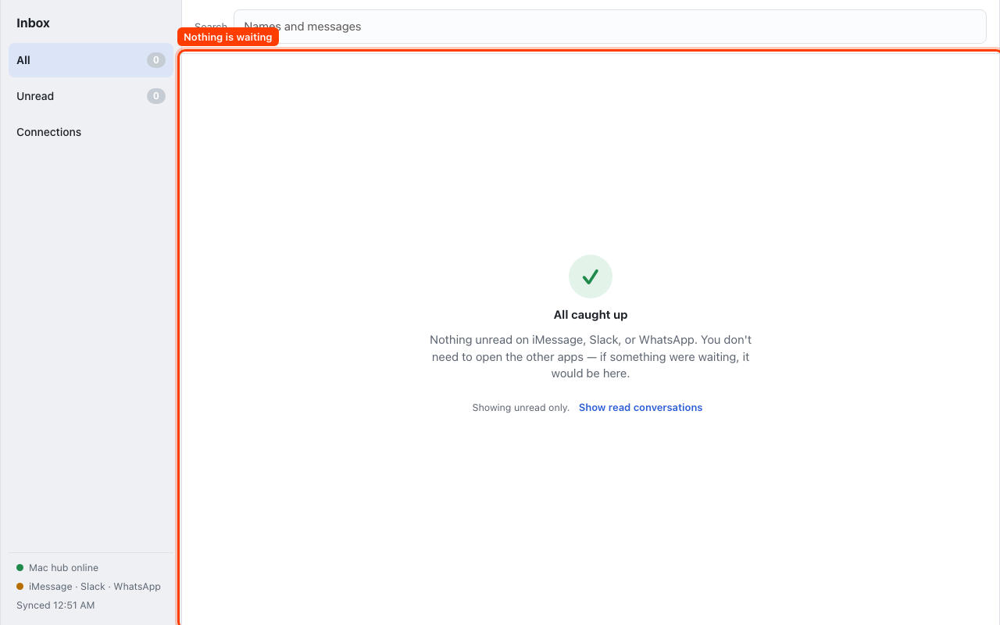

When nothing is unread anywhere, the inbox says so and reminds you that you do not need to open the other apps. **Show read conversations** brings back the list of everything you have already read.

## While it loads

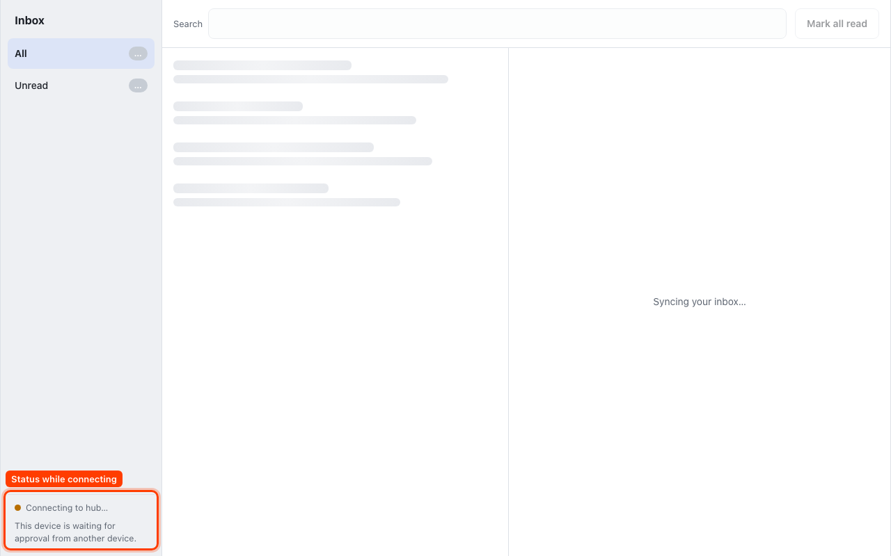

Before the first sync, the list shows gray placeholder rows, search and Mark all read are disabled, and the status reads "Connecting to hub…".

## When the Mac is unreachable

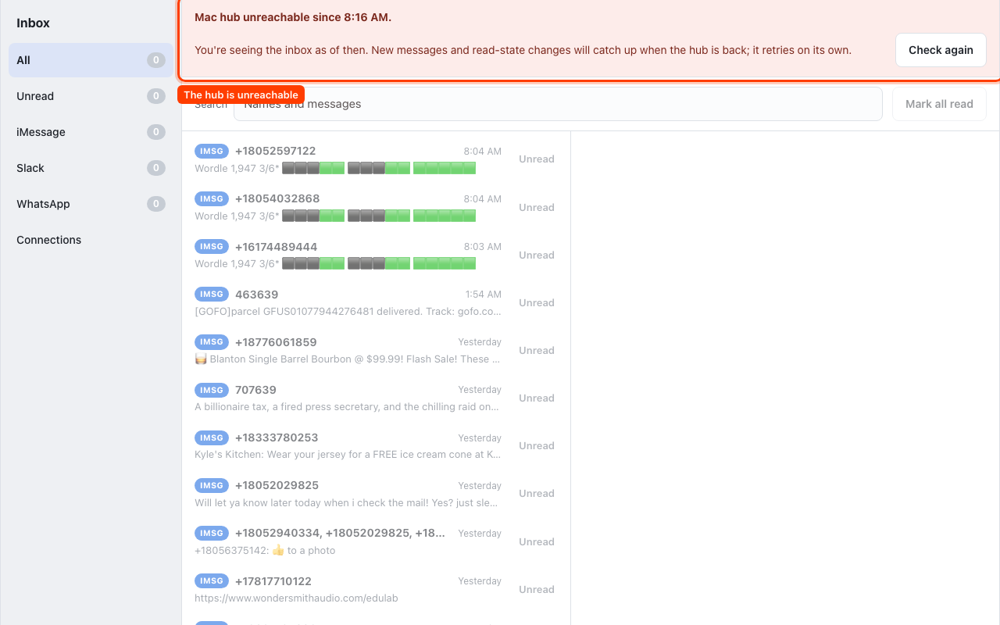

If your Mac is down or offline, a red banner says so and when it started, and the sidebar shows when the inbox last synced. You can still read everything that had arrived, and Reply still works because it only needs the app in front of you. The Read and Mark unread controls are grayed out until the Mac is back. The inbox retries on its own; **Check again** retries now. Once the Mac is reachable again the inbox catches up without you doing anything.

## Connections

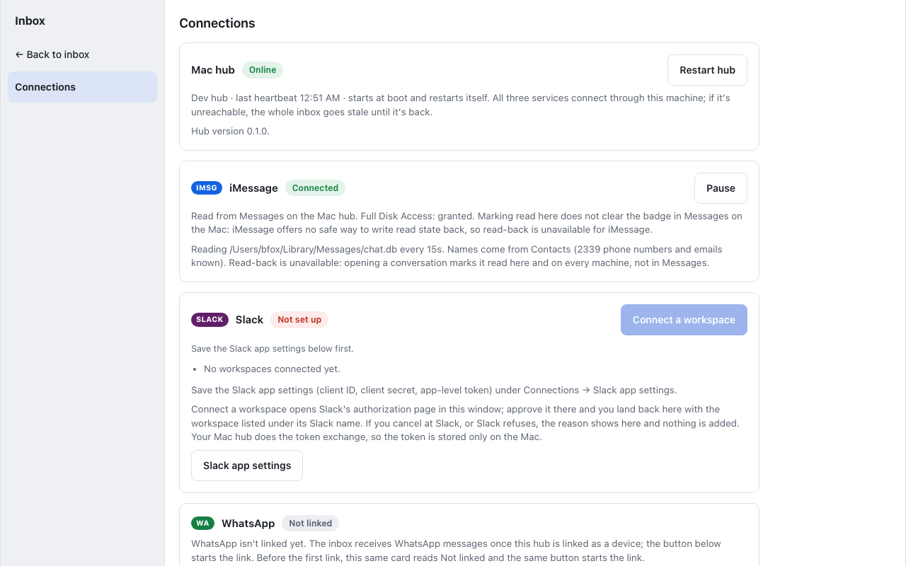

Connections is the inbox's settings screen. Reach it from the **Connections** link at the bottom of the sidebar, and return with **← Back to inbox**. It shows five cards.

### Mac hub

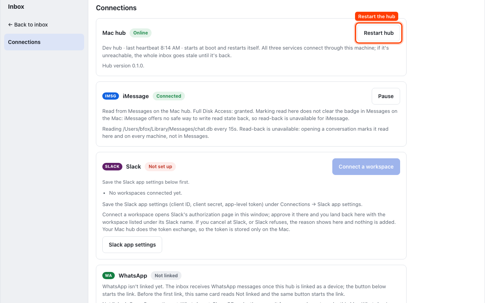

Whether your Mac is online and when it last checked in. **Restart hub** restarts the connector process on the Mac; it comes back within seconds.

### iMessage

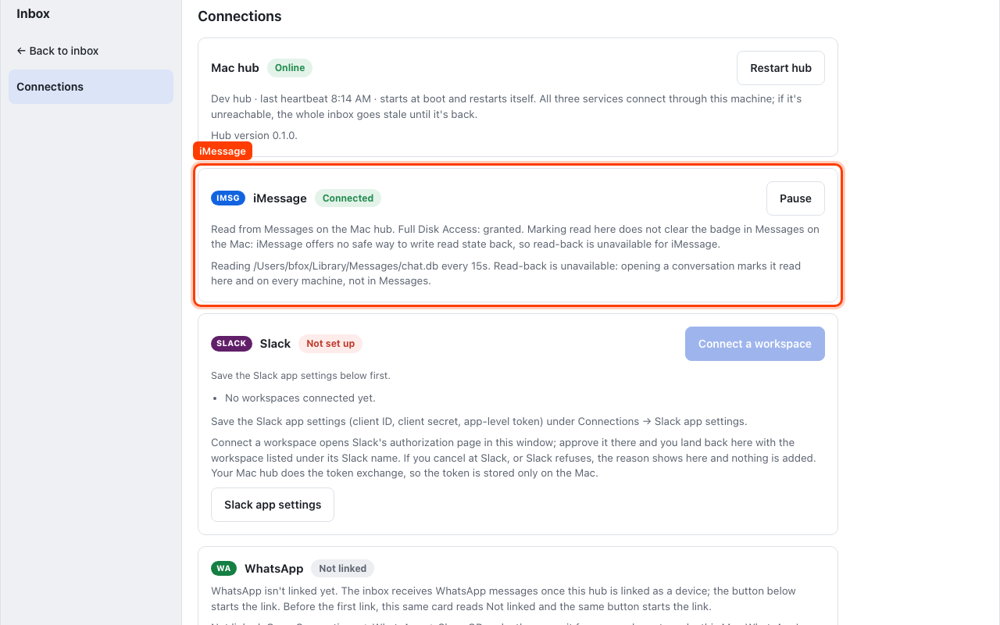

Whether the Mac can read Messages. If it says Full Disk Access is missing, open System Settings → Privacy & Security → Full Disk Access on the Mac and add the program the card names; the next check picks it up. **Pause** stops reading Messages until you press **Resume**.

Conversations and senders are labelled the way Messages labels them: with the name on the Contacts card for that phone number or email, and with the number or address itself when there is no card. Add or fix a card in Contacts on the Mac and the conversation is renamed at the next check, within about fifteen seconds. The card's status line says how many numbers and addresses Contacts knows, or why Contacts could not be read.

### Slack

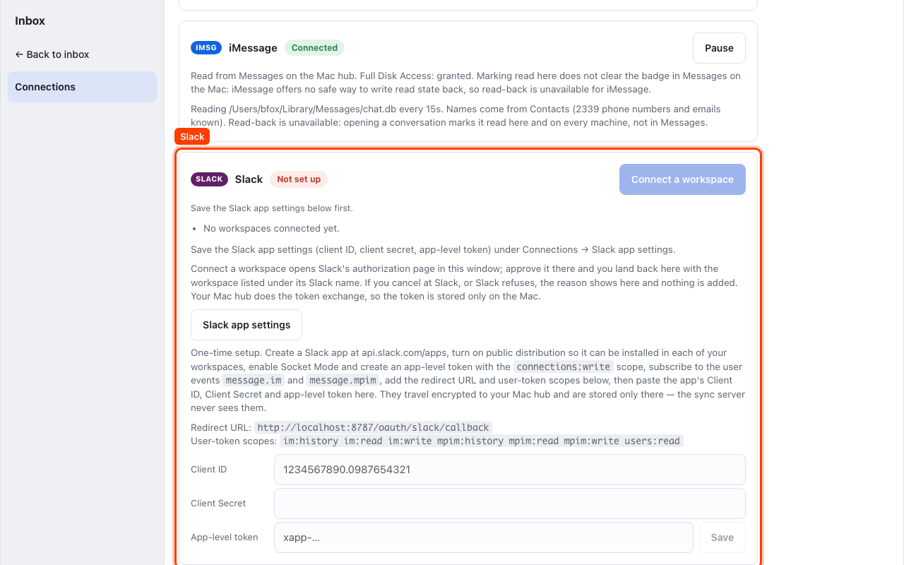

Lists your connected workspaces. **Connect a workspace** sends this window to Slack's own authorization page; approve there and you land back here with the workspace listed and its direct messages flowing in. If you cancel at Slack, you come back with the reason shown and nothing changed. **Remove** stops a workspace's messages and revokes its access.

One thing happens only once. Slack grants access only to a registered app, so open **Slack app settings** and create the app it describes at api.slack.com/apps: turn on public distribution so it can be installed in each of your workspaces, enable Socket Mode and create an app-level token, subscribe to the user events `message.im` and `message.mpim`, add the listed user-token scopes, and register the redirect URL the panel shows. Paste the app's client ID, client secret, and app-level token and press **Save**. They travel encrypted to your Mac and are stored only there.

### WhatsApp

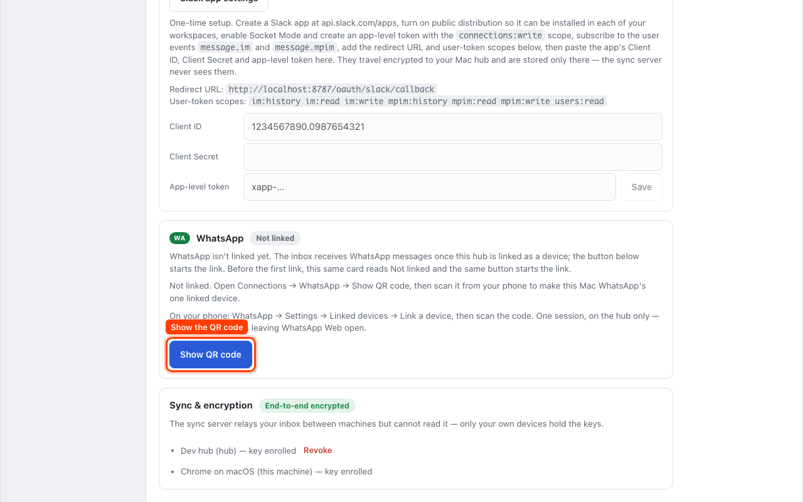

The first time, the card reads **Not linked**. Press **Show QR code**, then on your phone open WhatsApp → Settings → Linked devices → Link a device and scan it. One scan links your Mac as a device, the same way WhatsApp Web works. WhatsApp ends linked-device sessions now and then; when that happens the card says **Session expired**, and the same button relinks it.

### Sync and encryption

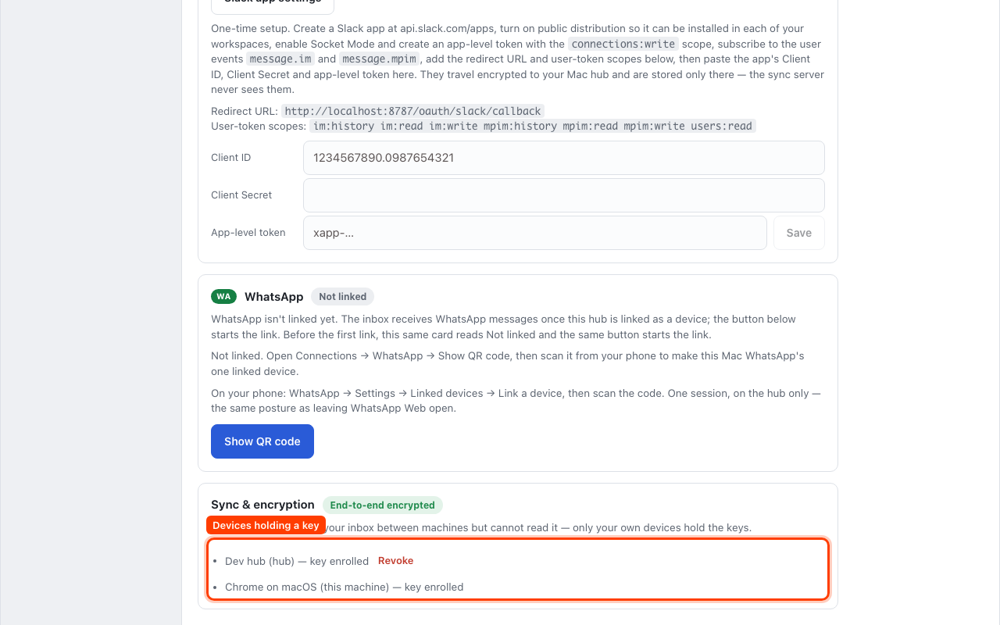

The server that relays your inbox between machines cannot read it; only your own devices hold the keys. This card lists every device that holds a key. A new device waiting to join appears here with **Approve** and **Decline**; **Revoke** removes a device you no longer use.

## If something goes wrong

- **The inbox says the Mac is unreachable.** Check that the Mac is on and online. If it is, press **Restart hub** on the Connections screen, or restart the connector from the Mac itself (see the README).
- **A service card shows an error.** The card's text names the cause. Slack errors come from Slack's own messages; WhatsApp usually needs a relink; iMessage usually needs Full Disk Access.
- **A new phone or computer is stuck on "waiting for approval".** Approve it from the Sync and encryption card on a device that is already in.
